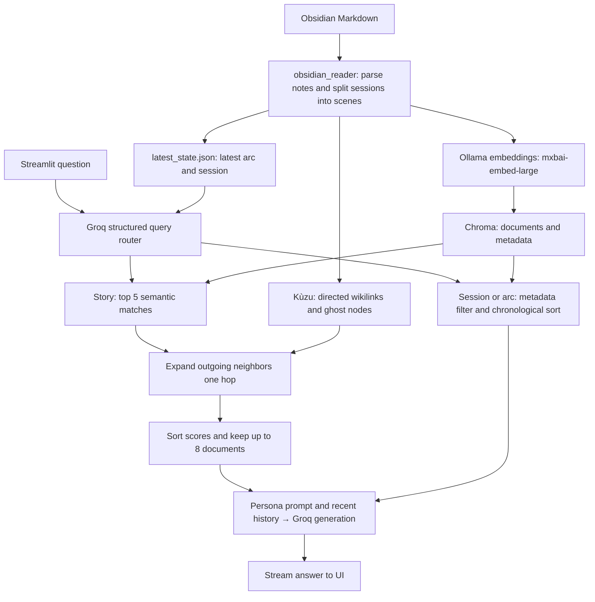

# Graph-Aware RAG for D&D Campaign Notes

A personal Python project that helps players and dungeon masters ask questions about linked Obsidian campaign notes. It combines semantic retrieval with the notes’ explicit links, so context can include related characters, places, and scenes beyond the initial vector matches.

The Streamlit app streams answers and offers campaign personas, conversation history, and LLM-based routing for lore questions, session recaps, and arc summaries. This is a prototype, with no benchmark or production-readiness claims.

## Architecture



For story queries, linked documents inherit their seed’s relevance score multiplied by `0.9`. The final selection is score sorting, **not a learned reranker**, and has no relevance threshold. Only outgoing links are traversed. Links to missing notes create ghost nodes, which retrieval skips if no corresponding vector document exists. Links to session titles are expanded into scene links during ingestion.

## Stack

| Component | Purpose |
| --- | --- |
| Python | Parsing, ingestion, and application logic |
| LangChain Core and integrations | Prompt composition, structured routing, streaming, and storage adapters |
| Ollama / `mxbai-embed-large` | Local embeddings for ingestion and story queries |
| ChromaDB | Persistent document vectors and metadata filtering |
| Kùzu | Embedded directed graph of note links |
| Groq / `llama-3.3-70b-versatile` | Hosted query routing and response generation |
| Streamlit | Chat UI, persona selection, and history display |
| Pydantic / python-dotenv | Route schema and local configuration |

Ollama is used for embeddings, not answer generation. Groq requires an account, API key, network access, and available quota; provider charges may apply. Retrieved notes and conversation context are sent to Groq. Local logs can contain questions, note text, and retrieval details.

## Setup

Run commands from the repository root. Python **3.13** is the locally checked interpreter; historical bytecode also indicates 3.12 use, but no supported-version matrix exists. Direct dependencies are pinned to the installed versions used for local checks; transitive dependencies are not locked.

```bash
python3.13 -m venv .venv
source .venv/bin/activate
python -m pip install -r requirements.txt
cp .env.example .env
```

Edit `.env` and set `GROQ_API_KEY` to your own key. The sample file also sets `NOTES_LOCATION` and `DATABASE_LOCATION` to synthetic input and separate generated storage. Existing shell environment values take precedence over `.env`.

Install [Ollama](https://ollama.com/), start its service (desktop app or `ollama serve` in another terminal), then download the embedding model:

```bash
ollama pull mxbai-embed-large
```

No provider credentials are needed for ingestion; the local Ollama service and model are required. The default, when no overrides are configured, remains `../mha_notes` with storage under `./database`. Never mix private and sample notes in one database. Use a fresh `DATABASE_LOCATION` when changing datasets; ingestion does not remove stale documents or links.

### Index the synthetic example

The five original fictional notes under `examples/notes` contain no personal campaign material.

```bash
python -m src.obsidian_reader
```

This loads characters and structures, splits sessions into scenes, stores vectors and links, resolves session references, and writes the latest arc/session state. The legacy command `python src/obsidian_reader.py` also remains available.

### Start the interface

Stop ingestion before starting the UI; both use the same embedded storage.

```bash
streamlit run app.py
```

Select **assistant** in the sidebar for the fictional example. Other personas retain the original campaign-specific identity prompts and are not tailored to these notes. Ask:

> Who owns the moon lantern, and where was it recovered?

The router should classify this as a story query. Semantic retrieval supplies initial notes; outgoing links can add related characters, locations, or session scenes. The answer should describe ownership and recovery using the retrieved fictional notes. Exact wording and selected documents depend on embeddings and the hosted model; no live output is claimed here.

Try `Summarize Arc 1 Session 1` for a session route, or `Summarize Arc 1` for an arc route. These filter metadata and sort scene content rather than performing vector search. Routing still uses Groq.

### Input format

- Characters: `characters/*.md`; players: `characters/players/*.md`.
- Structures: `structures/*.md`, starting exactly with `# Description`, `# Members`, or `# Location`.
- Sessions: lowercase folders such as `arc 1/`, with filenames such as `Arc 1 Session 1.md`. Scenes start with `### `; text before the first scene is not indexed.
- `[[note name]]` and `[[note name|display alias]]` become lowercase graph targets. Use unique lowercase filename stems for reliable matching. `[[Arc 1 Session 1]]` references resolve to the corresponding scenes. Heading/path-qualified wikilinks are not specially normalized.
- Session scene IDs use `arc_session_scene`, with scene numbering starting at zero. Optional scene tags use `### Heading #tag`; `#todo` is removed from indexed content.

## Project structure

```text
app.py                       Streamlit chat interface
src/
  obsidian_reader.py         Markdown parsing and indexing
  config.py                  Paths, embeddings, vector store, retrieval settings
  graph_db.py                Kùzu schema and graph operations
  graphRAG_retriever.py       Story, session, and arc retrieval
  chat_bot.py                Routing, prompts, streaming, conversation window
  models.py / prompts.py     Structured route schema and persona prompts
  logger_config.py           Local retrieval/chat logs
examples/notes/              Synthetic linked campaign
.env.example                 Placeholder configuration
requirements.txt             Direct dependencies
```

## Limitations and future work

- No quality evaluation, citations in the UI, learned reranker, multi-hop traversal, or offline answer model. Graph expansion favors links regardless of their semantic usefulness.
- The UI caches one chatbot resource, including its internal history, across sessions. Treat it as a local single-user tool; multi-user history isolation needs work before hosting.
- Parsing assumes a specific vault layout. Player notes are currently traversed twice (as characters and players); IDs overlap on the same filenames. Nested paths, duplicate names, deleted notes, and renamed links need better handling.
- Graph queries interpolate note names and paths directly. Use trusted notes; parameterized queries and clearer validation would improve robustness.
- Graph and vector updates are not transactional. Indexing changes or failed runs can leave inconsistent/stale data; use separate fresh storage for experiments.
- Session/arc summaries can exceed model context limits. Routing can omit required numbers; errors and missing model/service/state conditions have limited handling.
- Chat history retains six messages, not a persistent conversation archive. Logs are local and unredacted.

## Verification and privacy

See [REVIEW_NOTES.md](REVIEW_NOTES.md) for local checks, the historical-data review, and proposed GitHub About text. `.gitignore` excludes local secrets, environments, notes, indexes, and logs; it does not remove artifacts already present in Git history. The owner has confirmed that the historical databases and logs contain test data and can remain public.
